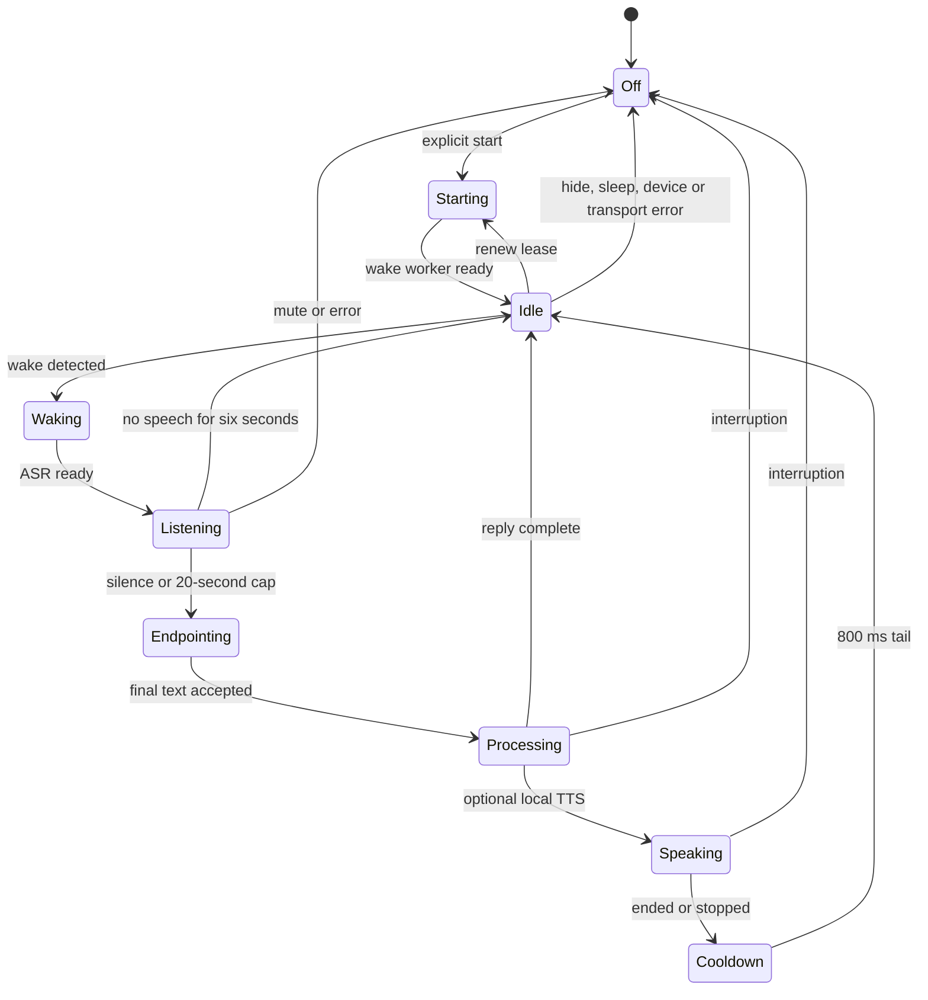

# Local hands-free voice — beta.11

Start explicitly in **設定 → 音声入力 → 呼びかけで会話する**. Save the local ASR
connection first, clear the composer/attachments, then press **待機開始・発話を自動送信**.
Say the installed model's phrase (for example English “Hey Jarvis”), pause until
**聴いています**, then speak. Completed utterances use the same resident character
and existing request-ID/draft protections as typed input. Worker jobs keep their
independent lanes, permissions and approval requirements. The pi-ai external
provider bridge and conversation recipient remain unchanged.

The top-bar microphone state is also the immediate mute/interruption control.
During character processing it additionally requests Stop for that main session,
leaving unrelated workers running. Manual capture and typed sends end standby.
Hidden pages, app hide, sharing, device loss, sleep and errors require explicit
restart; nothing restarts on launch/reconnect/resume or from a saved preference.

## Explicit local setup

Nothing automatically installs packages, downloads models, acquires keys or
launches workers. Use optional dependencies you have installed yourself. Review
checkpoint licenses; openWakeWord code and pretrained checkpoints differ.

1. Install openWakeWord/ONNX runtime separately and provide **three existing
   compatible files** (wake word, melspectrogram, embedding):

   ```sh
   python workers/wake_server.py --model /models/hey_jarvis.onnx \
     --melspec-model /models/melspectrogram.onnx \
     --embedding-model /models/embedding_model.onnx
   ```

   Default: `http://127.0.0.1:8769`. Override the Tepora service's
   `TEPORA_WAKE_URL` for another **loopback** endpoint. External URLs are refused
   even with cloud consent. Optional `TEPORA_SPEECH_TOKEN` must match in Tepora
   and both workers; it never reaches the browser or SQLite. The wake
   `--threshold` defaults to 0.5 and needs real-device tuning.

2. Use the existing streaming Qwen3 worker with its supported vLLM environment
   and previously installed checkpoint (defaults unchanged):

   ```sh
   python workers/speech_server.py --model /models/qwen3-asr
   ```

   Alternatively, install **faster-whisper** separately and supply an existing
   CTranslate2 model directory containing `model.bin`, `config.json` and
   `tokenizer.json`:

   ```sh
   python workers/endpoint_whisper.py --model /models/whisper-small --threads 2 --language ja
   ```

   This optional adapter uses CPU int8, one decoder and one decode at utterance
   finish; chunks do no inference. Threads are bounded to 1–8, PCM to 30 seconds
   (1.92 MB). The model stays resident, so model RAM still matters. Cancellation
   suppresses late text; native decoding can drain before the next turn. There
   is no cloud fallback or automatic model fetch.

3. Set **リアルタイム音声ワーカーのURL** to `http://127.0.0.1:8768`, enable
   audio input, disable dictation editing and save. Text works without workers.

The optional per-start readout checkbox uses only an **enabled device** TTS
profile selected under 能力の接続. It never selects cloud TTS automatically.
Generated TTS audio uses the existing media-job storage, disclosed in the UI;
microphone audio is not persisted. Conversation text keeps its normal history
and configured model recipient.

## State and resource limits



`web/hands-free-voice.mjs` owns one microphone graph. Off has no capture,
inference requests or controller timers. Idle sends only to the wake worker;
ASR starts after detection. Orchestration never calls a model.

The streaming resampler emits exactly 3,200 Float32 samples (200 ms at 16 kHz),
retaining fractional boundaries across render blocks. Its internal buffer is
fixed. The browser queue holds at most ten chunks (**128,000 PCM bytes**) plus
one request in flight. Worklet delivery also requires acknowledgements: at most
two PCM messages (25,600 bytes) can wait on the main thread, alongside its
12,800-byte producer buffer. Missing acknowledgements latch one overflow and
stop processing. Overflow mutes rather than losing part of a command.
Telemetry is bounded in-memory counters; there is no per-frame SQLite/log write.

Endpointing uses a **local energy gate, not a trained speech VAD**: RMS 0.012,
at least 300 ms voiced audio and 800 ms trailing silence. No speech for six
seconds abandons capture. Turns cap at 20 seconds with a 22-second stalled-worker
watchdog. This needs real-room tuning; noise/speaker identification is not
provided. A learned VAD remains future work.

TTS generation/playback gates incoming audio, followed by an 800 ms acoustic
tail and fresh wake session. This is **half duplex**: use the visible interruption
control during speech, then explicitly restart. Echo cancellation is requested
but not assumed sufficient for voice barge-in. Other room audio can still cause
false activations. There is no voice-only interruption during TTS yet.

Wake sessions renew after 110 seconds within the shared 120-second server
lease. Device/worker loss, malformed replies, audio heartbeat loss and a clock
gap over ten seconds fail closed. Resume does not restart capture. Browser/OS
background-capture restrictions are preserved.

`POST /api/voice/wake/start` reuses the existing speech owner in Node and
`--dev-native --agent`. Ordered/bounded `chunk`, `cancel`, `finish` stay shared;
wake chunks add a strict boolean `detected`. The effect-free native mode returns
503. No speech route itself submits a conversation or runs a tool. Node now
aborts transport and rejects late results after cancellation, like native.
Remote cancellation is best effort when a session ID never reached the host.

## Backend choice and verification

The existing PCM, Qwen ASR, device TTS and pi-ai interfaces are retained.
openWakeWord supplies a CPU wake adapter instead of running general ASR on idle
audio. Its [model implementation](https://github.com/dscripka/openWakeWord/blob/main/openwakeword/model.py)
and [feature implementation](https://github.com/dscripka/openWakeWord/blob/main/openwakeword/utils.py)
define local model paths, reset and 80 ms PCM16 frames. Float32 conversion keeps
less than one frame between predictions. [faster-whisper](https://github.com/SYSTRAN/faster-whisper)
provides optional endpoint-only CPU int8 decoding. No new inference engine was
introduced. Actual model RSS, wake recall, false activations and ASR/TTS latency
have **not** been measured in this cloud host.

`node scripts/bench-voice.mjs` measures synthetic 60-second preprocessing at
four rates; `--baseline /path/to/old-worklet.js` compares a supplied source. It
accesses no microphone, model or network. VM timing does not establish browser
AudioWorklet deadlines. See [QA](QA.md) for synthetic test/benchmark results.

Hardware acceptance remains: compatible real checkpoints, accents, quiet/noisy
rooms, speakers/headphones and feedback, ASR latency/RAM, TTS autoplay, unplug,
sleep/resume, Windows/macOS native WebViews and packaged background behavior.
See [STATUS](STATUS.md), [BETA11](BETA11.md) and [native speech](RUST-SPEECH-STREAM.md).
