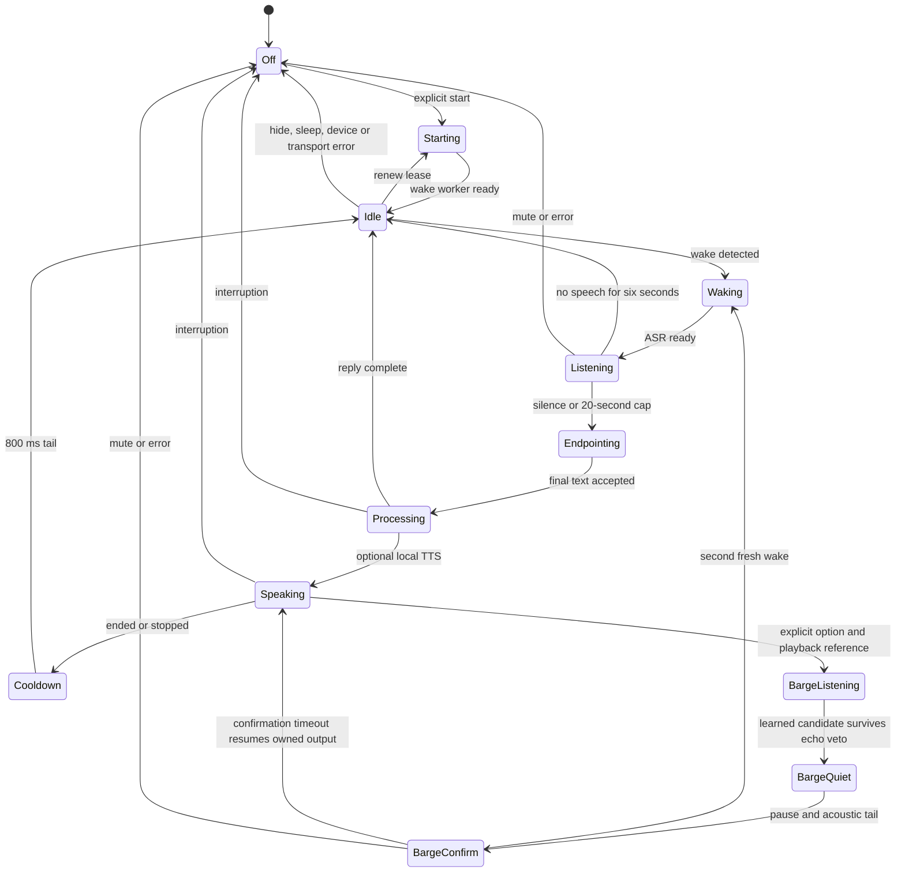

# Local hands-free voice — beta.11

Start explicitly in **設定 → 音声入力 → 呼びかけで会話する**. Save the local ASR
connection first, clear the composer/attachments, then press **待機開始・発話を自動送信**.
Say the installed model's phrase (for example English “Hey Jarvis”), pause until
**聴いています**, then speak. Completed utterances use the same resident character
and existing request-ID/draft protections as typed input. Worker jobs keep their
independent lanes, permissions and approval requirements. The pi-ai external
provider bridge and conversation recipient remain unchanged.

The top-bar microphone state is also the immediate mute/interruption control.
During character processing it additionally requests Stop for that main session,
leaving unrelated workers running. Manual capture and typed sends end standby.
Hidden pages, app hide, sharing, device loss, sleep and errors require explicit
restart; nothing restarts on launch/reconnect/resume or from a saved preference.

## Explicit local setup

Nothing automatically installs packages, downloads models, acquires keys or
launches workers. Use optional dependencies you have installed yourself. Review
checkpoint licenses; openWakeWord code and pretrained checkpoints differ.

1. Install openWakeWord/ONNX runtime separately and provide **three existing
   compatible files** (wake word, melspectrogram, embedding):

   ```sh
   python workers/wake_server.py --model /models/hey_jarvis.onnx \
     --melspec-model /models/melspectrogram.onnx \
     --embedding-model /models/embedding_model.onnx
   ```

   Default: `http://127.0.0.1:8769`. Override the Tepora service's
   `TEPORA_WAKE_URL` for another **loopback** endpoint. External URLs are refused
   even with cloud consent. Optional `TEPORA_SPEECH_TOKEN` must match in Tepora
   and both workers; it never reaches the browser or SQLite. The wake
   `--threshold` defaults to 0.5 and needs real-device tuning.

2. Use the existing streaming Qwen3 worker with its supported vLLM environment
   and previously installed checkpoint (defaults unchanged):

   ```sh
   python workers/speech_server.py --model /models/qwen3-asr
   ```

   Alternatively, install **faster-whisper** separately and supply an existing
   CTranslate2 model directory containing `model.bin`, `config.json` and
   `tokenizer.json`:

   ```sh
   python workers/endpoint_whisper.py --model /models/whisper-small --threads 2 --language ja
   ```

   This optional adapter uses CPU int8, one decoder and one decode at utterance
   finish; chunks do no inference. Threads are bounded to 1–8, PCM to 30 seconds
   (1.92 MB). The model stays resident, so model RAM still matters. Cancellation
   suppresses late text; an already running native decode must drain. Finishes
   never queue behind it: a busy finish discards that capture and returns HTTP
   429. Wait for the running call to drain, then explicitly restart standby and
   speak again; the rejected recording is not retried. There is no cloud
   fallback or automatic model fetch.

3. Set **リアルタイム音声ワーカーのURL** to `http://127.0.0.1:8768`, enable
   audio input, disable dictation editing and save. Text works without workers.

The optional per-start readout checkbox uses only an **enabled device** TTS
profile selected under 能力の接続. It never selects cloud TTS automatically.
Generated TTS audio uses the existing media-job storage, disclosed in the UI;
microphone audio is not persisted. Conversation text keeps its normal history
and configured model recipient.

## State and resource limits



`web/hands-free-voice.mjs` owns one microphone graph. Off has no capture,
inference requests or controller timers. Idle sends only to the wake worker;
ASR starts after detection. Orchestration never calls a model.

The streaming resampler emits exactly 3,200 Float32 samples (200 ms at 16 kHz),
retaining fractional boundaries across render blocks. Its internal buffer is
fixed. The browser queue holds at most ten chunks (**128,000 PCM bytes**) plus
one request in flight. Worklet delivery also requires acknowledgements: at most
two PCM messages (25,600 bytes) can wait on the main thread, alongside its
12,800-byte producer buffer. Missing acknowledgements latch one overflow and
stop processing. Overflow mutes rather than losing part of a command.
Telemetry is bounded in-memory counters; there is no per-frame SQLite/log write.

Endpointing uses a **local energy gate, not a trained speech VAD**: RMS 0.012,
at least 300 ms voiced audio and 800 ms trailing silence. No speech for six
seconds abandons capture. Turns cap at 20 seconds with a 22-second stalled-worker
watchdog. This needs real-room tuning; noise/speaker identification is not
provided. A learned VAD remains future work.

TTS generation/playback gates incoming audio, followed by an 800 ms acoustic
tail and fresh wake session. This is **half duplex**: use the visible interruption
control during speech, then explicitly restart. Echo cancellation is requested
but not assumed sufficient for voice barge-in. Other room audio can still cause
false activations. Optional two-stage voice interruption is described below; the default remains half duplex.

Wake sessions renew after 110 seconds within the shared 120-second server
lease. Device/worker loss, malformed replies, audio heartbeat loss and a clock
gap over ten seconds fail closed. Resume does not restart capture. Browser/OS
background-capture restrictions are preserved.
Heartbeat timestamps start after microphone permission, Worklet loading and
AudioContext resume complete, so a slow permission dialog is not treated as
sleep after healthy capture starts.

`POST /api/voice/wake/start` reuses the existing speech owner in Node and
`--dev-native --agent`. Ordered/bounded `chunk`, `cancel`, `finish` stay shared;
wake chunks add a strict boolean `detected`. The effect-free native mode returns
503. No speech route itself submits a conversation or runs a tool. Node now
aborts transport and rejects late results after cancellation, like native.
Remote cancellation is best effort when a session ID never reached the host.
The Node host frames worker JSON with its UTF-8 byte Content-Length, matching
the shipped Python server's bounded body parser, including non-ASCII session
IDs. Tests cover that parser directly rather than substituting its HTTP layer.

## Experimental voice interruption

This is an explicit per-start checkbox, off by default. Start the local wake
worker with `--barge-in`; it loads a second independent reference detector from
those same explicitly installed model files. The microphone track must report
`echoCancellation: true`; absent/false is rejected. That setting reports browser
configuration, **not measured acoustic quality**.

The playing same-origin TTS element is routed through the microphone's AudioContext,
with its reference connected to a separate Worklet input. Both streams share one
render clock and resampler. During actual playback, `/api/voice/barge/start`
opens a two-channel wake session; chunks contain 3,200 microphone/reference
pairs. Generation with no playing element does not enable barge-in. During
normal idle the reference path is disabled and only mono wake inference runs.

The worker feeds reference audio before microphone audio, rejects reference wake
phrases for `--reference-veto-seconds` (default 2, bounds 0.5–5), and vetoes
waveforms correlated with current or delayed playback over `--echo-window-ms`
(default 500, bounds 40–2000). Normalized correlation is insensitive to gain and
polarity, and checks every sample delay using a bounded FFT. With the default
window, the first 800 ms of a new reference session are ambiguous and cannot
produce a candidate. A learned microphone wake detection is required; reference
energy or a residual-energy threshold never initiates interruption.

A surviving candidate **pauses**, rather than cancels, its exact TTS element.
Quiet ownership uses that exact element's synchronous `paused` flag before
awaiting worker cancellation, independently of the browser's queued `pause` event.
After the configured 800–3000 ms acoustic tail (default 1200), a newly reset mono
wake session requires another wake phrase. No old PCM or detector state is reused.
A second wake cancels only the paused readout and opens ASR for a new utterance.
Without confirmation within five seconds, the exact owned readout can resume;
manual mute, new playback, deletion, hidden/shared state, device loss and stale
timers cannot resume or cancel replacement output. The top-bar state explains
when to repeat the wake phrase. No UI click is needed for this interruption path.

Dual-channel queue limits are ten pairs of chunks (**256,000 PCM bytes**), two
outstanding Worklet messages (**51,200 bytes**) and a fixed **25,600-byte**
producer buffer. Server sample/time budgets count each channel correctly, with
one shared wake/ASR slot, serial requests and the same cancellation/Stop limits.
The extra detector and reference work are opt-in; real model RSS is unmeasured.
Finished/replaced playback sources are disconnected and removed from strong
cleanup sets; only the active or confirmation-paused source stays connected.
The per-element cache is weak so same-element resume does not create a second
MediaElementAudioSource. A synthetic 500-readout check covers these bounds.

The endpoint Whisper worker admits at most one running decode and retains no
queued finish waveforms. A new active capture can still buffer up to 30 seconds
(1.92 MB) while an older cancelled native call drains; a busy finish drops that
new capture immediately. Thus the PCM bound is one active capture plus one
running waveform, not an accumulating queue of cancelled finish threads.

These are conservative rejection/confirmation gates, **not an acoustic echo
canceller or proof of robust speakerphone operation**. Nonlinear distortion,
multiple echoes beyond the selected window/tail, clock/device behavior and
browser/OS AEC need real microphones and speakers. Ambiguous double-talk can be
rejected, especially when TTS itself says the wake phrase. A native WebRTC/Speex
AEC integration would require correctly timed playback reference, device testing
and platform support; a new general inference engine would not solve that.
The [Speex echo-cancellation guidance](https://speex.org/docs/manual/speex-manual/node7.html)
describes reference timing and hardware limitations; the
[Web Audio specification](https://www.w3.org/TR/webaudio-1.1/)
defines the reference graph. Hardware acceptance remains required before treating
this experimental option as reliable speakerphone barge-in.

## Backend choice and verification

The existing PCM, Qwen ASR, device TTS and pi-ai interfaces are retained.
openWakeWord supplies a CPU wake adapter instead of running general ASR on idle
audio. Its [model implementation](https://github.com/dscripka/openWakeWord/blob/main/openwakeword/model.py)
and [feature implementation](https://github.com/dscripka/openWakeWord/blob/main/openwakeword/utils.py)
define local model paths, reset and 80 ms PCM16 frames. Float32 conversion keeps
less than one frame between predictions. [faster-whisper](https://github.com/SYSTRAN/faster-whisper)
provides optional endpoint-only CPU int8 decoding. No new inference engine was
introduced. Actual model RSS, wake recall, false activations and ASR/TTS latency
have **not** been measured in this cloud host.

`node scripts/bench-voice.mjs` measures synthetic 60-second preprocessing at
four rates; `--baseline /path/to/old-worklet.js` compares a supplied source. It
accesses no microphone, model or network. VM timing does not establish browser
AudioWorklet deadlines. See [QA](QA.md) for synthetic test/benchmark results.

Hardware acceptance remains: compatible real checkpoints, accents, quiet/noisy
rooms, speakers/headphones and feedback, ASR latency/RAM, TTS autoplay, unplug,
sleep/resume, Windows/macOS native WebViews and packaged background behavior.
See [STATUS](STATUS.md), [BETA11](BETA11.md) and [native speech](RUST-SPEECH-STREAM.md).
